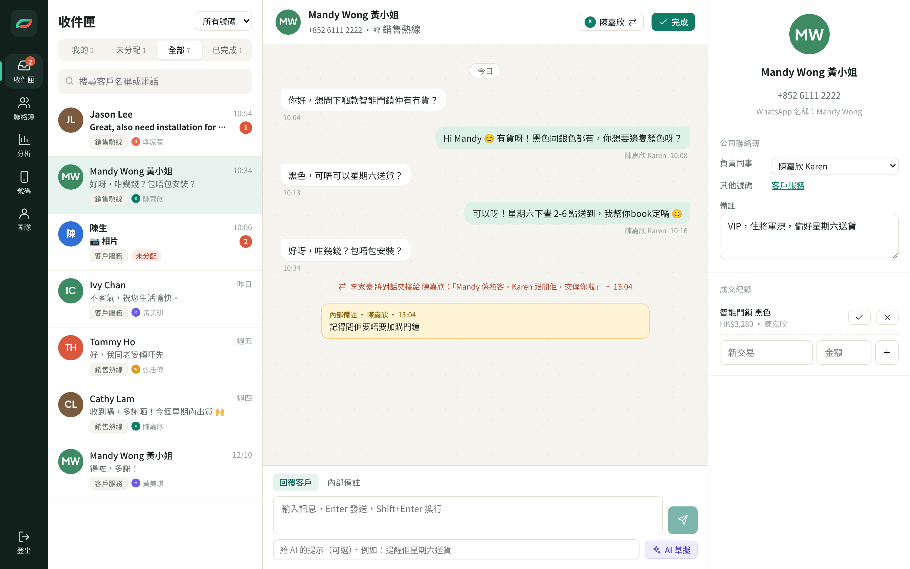
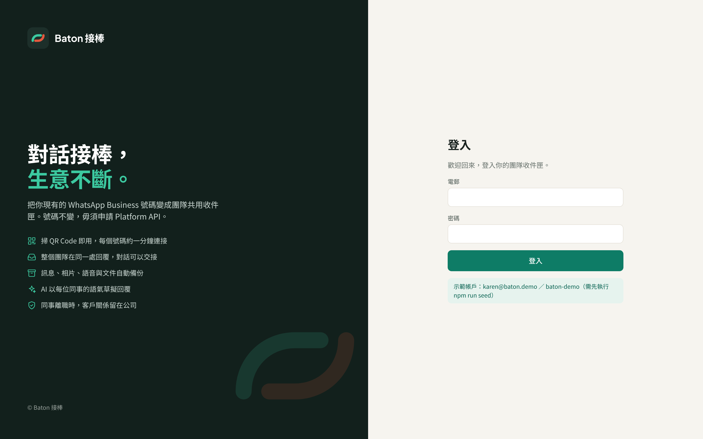
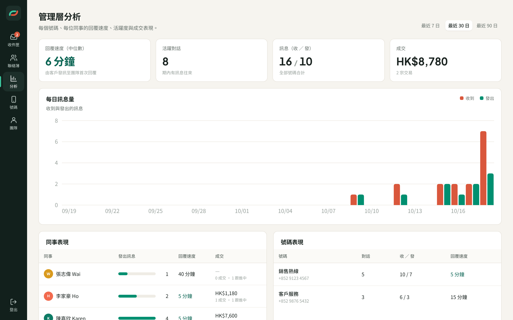
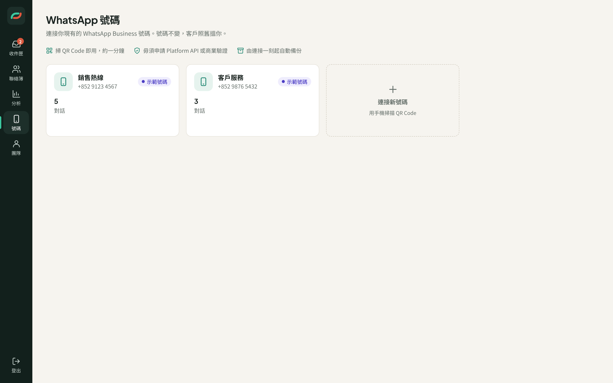
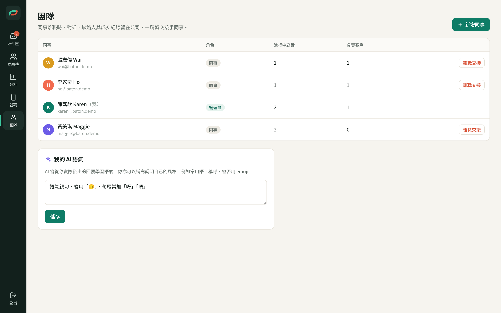

# Baton 接棒

**對話接棒，生意不斷。**

把你現有的 WhatsApp Business 號碼變成團隊共用收件匣。掃 QR Code 幾分鐘連接，毋須申請 Platform API 或商業驗證，號碼不變。對話自動備份，同事離職時客戶關係留在公司，AI 以每位同事的語氣草擬回覆。



## 核心功能

| 功能 | 實作 |
| --- | --- |
| **團隊共用收件匣** | 所有號碼的對話集中一處；「我的／未分配／全部／已完成」分類；分配與交接（附交接備註）；內部備註；即時同步（Socket.IO）。回覆未分配的對話會自動分配給自己，避免兩位同事同時回覆。 |
| **自動備份** | 每個已連接號碼的訊息（包括連接時同步的對話紀錄）寫入 SQLite；相片、影片、語音與文件下載到 `data/media/`；全文搜尋（FTS5 trigram，中英文都搜得到）。 |
| **AI 輔助回覆** | Claude 從同事**實際發出**的回覆學習語氣（加上同事自己寫的風格說明），按對話內容草擬回覆。同事檢查、修改後才發送，訊息會標示「AI 草擬」。 |
| **業務延續** | 「離職交接」即時停用登入，進行中的對話、負責的客戶及跟進中交易轉交接手同事；所有紀錄保留。 |
| **管理層分析** | 回覆速度（中位數）、每日訊息量、每位同事及每個號碼的表現、成交金額。 |
| **公司聯絡簿** | 每位客戶只有一筆資料，以電話號碼為準，所有號碼與同事共用。改名一次，所有收件匣同步更新。 |

## 運作原理

Baton 用 [Baileys](https://github.com/WhiskeySockets/Baileys) 把每個號碼連結為「已連結的裝置」，即 WhatsApp Web 用的同一個多裝置機制。所以：

- 不用申請 WhatsApp Business Platform（Cloud API），不用商業驗證，不用換號碼。
- 手機上的 WhatsApp Business 照常使用；在手機回覆的訊息同樣會備份，並標示「由手機發送」。

> ⚠️ **重要：** 這是非官方的連接方式，WhatsApp 的服務條款不容許非官方客戶端。號碼有機會被限制或封鎖，尤其是大量發送訊息或發送垃圾訊息時。Baton 設計為**人手回覆客戶**用的收件匣，不提供群發功能。正式推出前，請先評估這個風險，並考慮為重要號碼保留官方 Platform API 作後備。

```
手機 WhatsApp Business ──(已連結的裝置)──> Baileys socket（每個號碼一個）
                                              │
                                              ▼
            SQLite（訊息、聯絡人、交接、成交） + data/media（相片／語音／文件）
                                              │
                         Express REST API + Socket.IO 即時推送
                                              │
                                              ▼
                                   React 網頁版（團隊共用）
```

## 技術

- **後端：** Node.js 22+、TypeScript（`tsx`）、Express 5、Socket.IO、Baileys 7、`node:sqlite`（內建，不用編譯原生模組）、Anthropic SDK
- **前端：** React 19、Vite、純 CSS 設計 tokens（見 [docs/BRAND.md](docs/BRAND.md)）

```
server/src/
  index.ts       HTTP + Socket.IO 伺服器，提供 web/dist
  db.ts          SQLite schema 與輔助函數
  whatsapp.ts    QR 連接、重新連接、訊息與媒體備份、發送
  inbox.ts       儲存訊息、對話列表、時間線、事件
  ai.ts          以同事語氣草擬回覆（Claude）
  analytics.ts   回覆速度、活躍度、成交
  routes.ts      REST API
  seed.ts        示範資料
web/src/
  App.tsx        登入、導航、全域狀態
  pages/         Inbox、Contacts、Analytics、Numbers、Team
```

## 開始使用

需要 Node.js 22.5 或以上。

```bash
npm install
npm run build                  # 建立前端
npm run seed --workspace server  # 可選：建立示範資料
export ANTHROPIC_API_KEY=sk-ant-...   # 啟用 AI 草擬
npm start                      # http://localhost:4000
```

- **示範帳戶**（執行 seed 後）：`karen@baton.demo` ／ `baton-demo`。示範號碼不會連接 WhatsApp，但可以完整試用收件匣、交接、AI 草擬及分析。
- **正式使用：** 不執行 seed，直接開啟網頁，第一位用戶會成為管理員。然後到「號碼 → 連接新號碼」，在手機打開 WhatsApp Business → 設定 → 已連結的裝置 → 連結裝置，掃描 QR Code。

開發模式（前端熱重載，`/api` 經 Vite proxy 轉到 4000）：

```bash
npm run dev    # 前端 http://localhost:5173
```

### 環境變數

| 變數 | 預設 | 說明 |
| --- | --- | --- |
| `PORT` | `4000` | 伺服器端口 |
| `BATON_DATA_DIR` | `./data` | 資料庫、WhatsApp 登入資料、媒體檔案 |
| `ANTHROPIC_API_KEY` | | 啟用 AI 草擬 |
| `BATON_AI_MODEL` | `claude-opus-5-5` | AI 草擬用的模型 |
| `BATON_WA_LOG` | `warn` | Baileys 日誌等級 |
| `NODE_ENV` | | 設為 `production` 時 cookie 只經 HTTPS 傳送 |

`data/` 目錄包含 WhatsApp 登入資料及所有客戶對話，請妥善備份並限制存取權限。

## 截圖

| 登入 | 分析 |
| --- | --- |
|  |  |
| **號碼（QR 連接）** | **團隊（離職交接、AI 語氣）** |
|  |  |

## 尚未包括

- 發送相片／文件（目前可以接收及備份所有媒體，發送只支援文字）
- 群組對話（目前只處理一對一客戶對話）
- 雙重認證、更細緻的權限
- 多公司（multi-tenant）及收費
