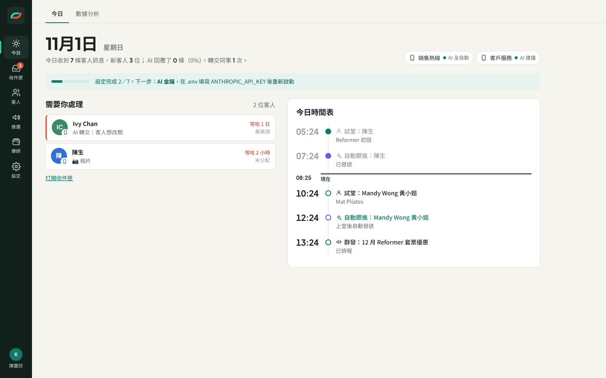
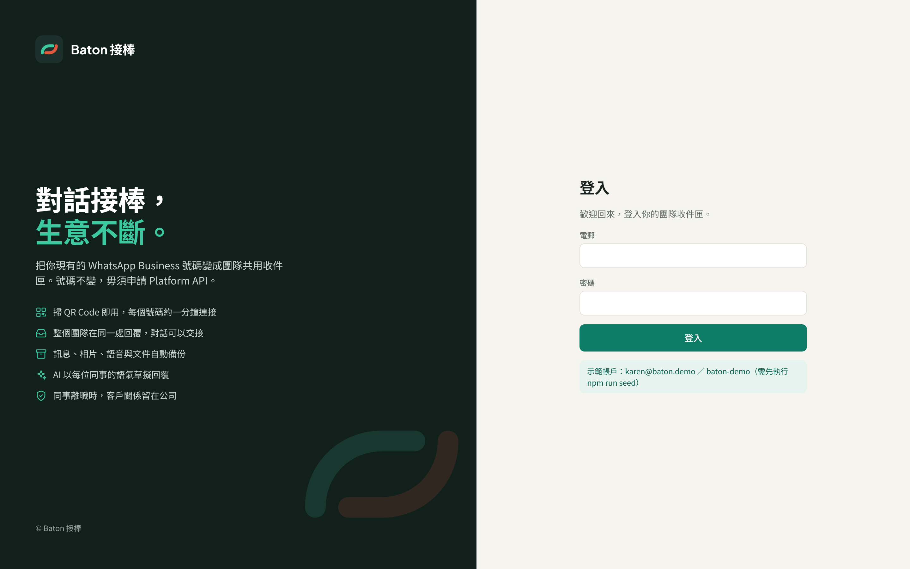
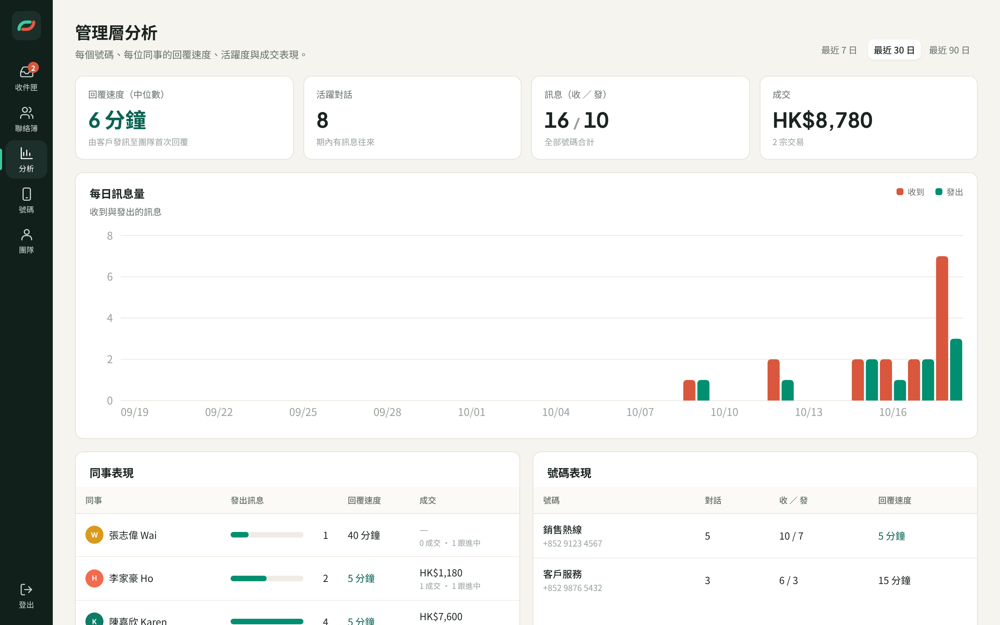
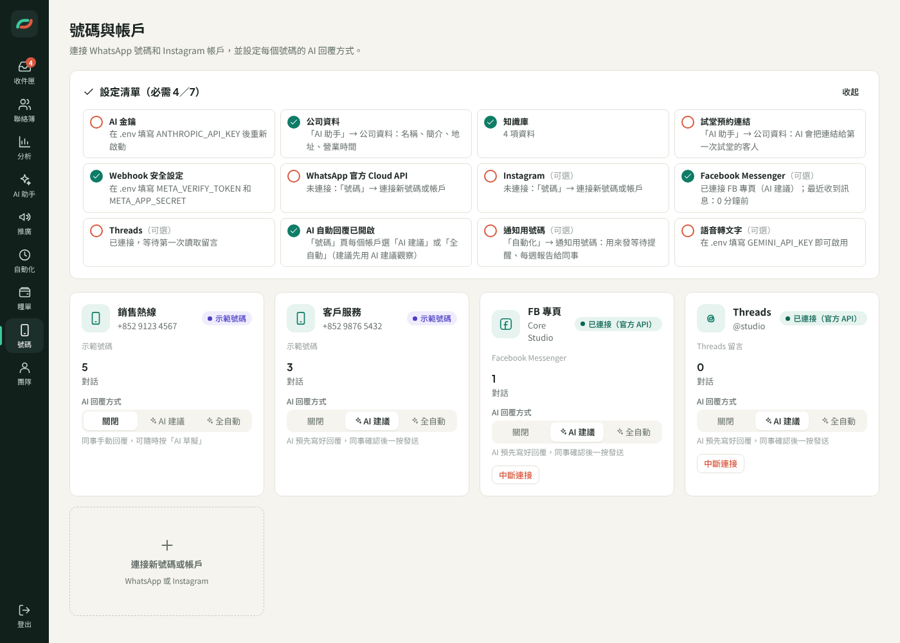
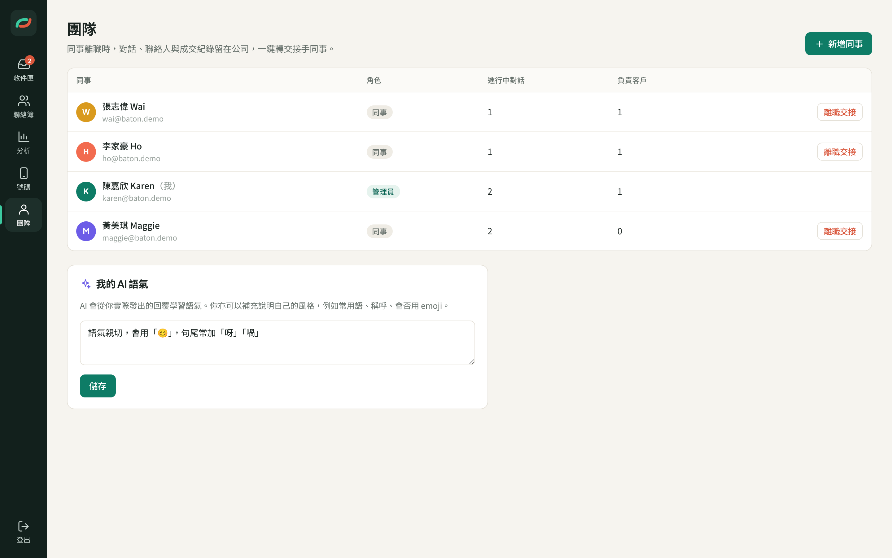
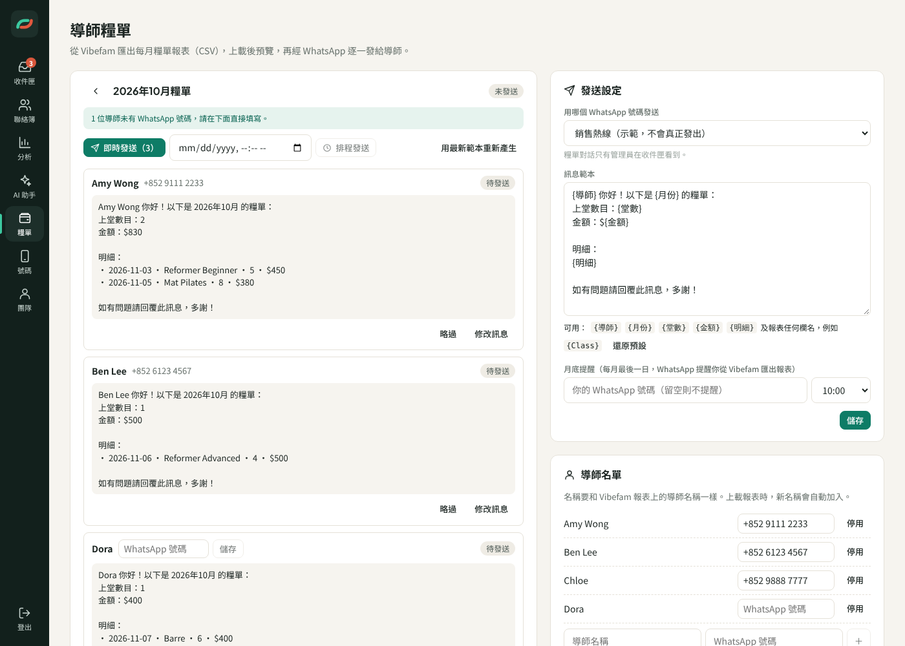
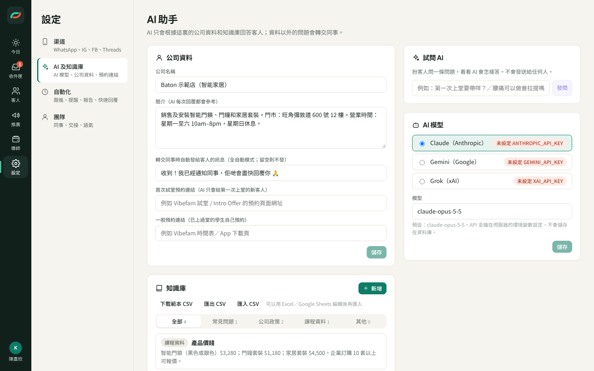
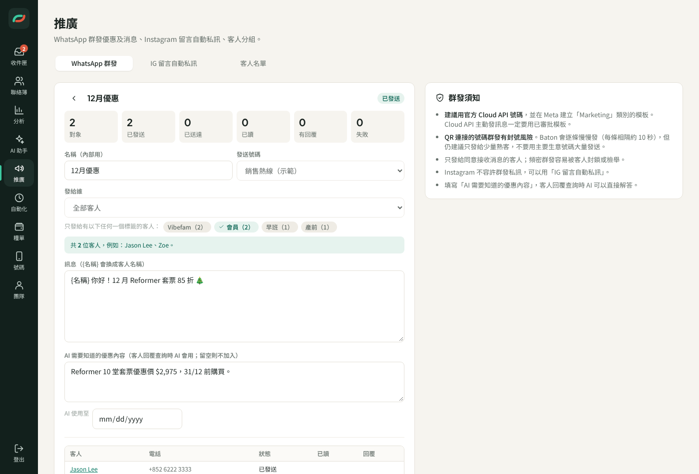

# Baton 接棒

**對話接棒，生意不斷。**

把 WhatsApp、Instagram、Facebook Messenger 和 Threads 變成團隊共用收件匣。可以掃 QR Code 幾分鐘連接現有號碼，也可以經 Meta 官方 API 連接。對話自動備份，同事離職時客戶關係留在公司。AI 根據公司知識庫回答客人：可以只草擬、預先建議，或全自動回覆，不確定時轉交同事。

> **第一次設定？** 請看 **[完整設定指南 docs/SETUP.md](docs/SETUP.md)**（本機或雲端安裝、Meta App、WhatsApp／IG／Facebook／Threads 逐步連接、App 審查、AI 設定及上線次序）：連接 WhatsApp／Instagram 官方 API、連接及轉換 AI 和模型、知識庫範本（[`docs/knowledge-template.csv`](docs/knowledge-template.csv)）及資料存放位置、轉用人工時在哪裡回覆客人。



## 核心功能

| 功能 | 實作 |
| --- | --- |
| **團隊共用收件匣** | 所有號碼的對話集中一處；「我的／未分配／全部／已完成」分類；分配與交接（附交接備註）；內部備註；即時同步（Socket.IO）。回覆未分配的對話會自動分配給自己，避免兩位同事同時回覆。 |
| **自動備份** | 每個已連接號碼的訊息（包括連接時同步的對話紀錄）寫入 SQLite；相片、影片、語音與文件下載到 `data/media/`；全文搜尋（FTS5 trigram，中英文都搜得到）。 |
| **AI 輔助回覆** | AI 從同事**實際發出**的回覆學習語氣（加上同事自己寫的風格說明），按對話內容和知識庫草擬回覆。同事檢查、修改後才發送，訊息會標示「AI 草擬」。 |
| **AI 自動回覆** | 每個號碼可設定「關閉／AI 建議／全自動」。常見問題按關鍵字直接用團隊寫好的答案回覆（不經 AI）；其他問題由 AI 根據知識庫回答；知識庫沒有的資料、預約／退款等要人手處理的事、投訴或要求真人時，轉交同事。同事一回覆，AI 就在該對話暫停，直到按「恢復 AI」或對話完成。 |
| **知識庫** | 「設定 → AI 及知識庫」頁面管理公司資料、常見問題、政策和課程資料；可以用 Excel／Google Sheets 編輯 CSV 再匯入或匯出；附普拉提／健身室範本；可以「試問 AI」預覽回答。 |
| **導師糧單** | 上載從 Vibefam 匯出的每月糧單報表（CSV），自動按導師整理、套用訊息範本，預覽後經 WhatsApp 逐一發給導師（即時或排程）；每月最後一日用 WhatsApp 提醒管理員上載。糧單對話只有管理員看到。 |
| **試堂流程** | AI 給新客人試堂預約連結（舊學生給一般預約連結）；客人告訴 AI 試堂時間後自動記錄；上堂後（預設 2 小時）自動發跟進訊息。 |
| **不漏客** | 客人等待太耐，WhatsApp 提醒負責同事；快速回覆（`/捷徑`）；語音訊息自動轉文字（Gemini）。 |
| **推廣** | 客人標籤及分組、WhatsApp 群發（即時／排程、測試、送達／已讀／回覆統計、AI 自動解答優惠）、IG 留言關鍵字自動私訊、匯入客人名單。 |
| **管理** | 每週 WhatsApp 營運報告、Google 評價邀請、一次通知多位導師。 |
| **待人工** | AI 轉交的對話集中在收件匣「待人工」分頁，同事直接在 Baton 回覆，訊息經原本的 WhatsApp／Instagram 發給客人。 |
| **多種 AI** | Claude、Gemini、Grok 任選，在「設定 → AI 及知識庫」頁面切換；API 金鑰只放在伺服器環境變數。 |
| **四個渠道** | WhatsApp Cloud API、Instagram、Facebook Messenger 經同一個 webhook 進入收件匣；Threads 帖子留言每 3 分鐘讀取一次並公開回覆。也支援 QR 連接的 WhatsApp。號碼頁有設定清單，顯示仍未完成的步驟。 |
| **業務延續** | 「離職交接」即時停用登入，進行中的對話、負責的客戶及跟進中交易轉交接手同事；所有紀錄保留。 |
| **管理層分析** | 回覆速度（中位數）、每日訊息量、每位同事及每個號碼的表現、成交金額。 |
| **公司聯絡簿** | 每位客戶只有一筆資料，以電話號碼為準，所有號碼與同事共用。改名一次，所有收件匣同步更新。 |

## 運作原理

### 連接方式

| 方式 | 適合 | 注意 |
| --- | --- | --- |
| **QR Code（已連結的裝置）** | 用現有 WhatsApp Business App 號碼，人手回覆 | 非官方，見下面的警告；不建議開全自動 |
| **WhatsApp 官方 Cloud API** | AI 自動回覆、正式營運 | 需要 Meta 開發者帳戶；號碼要搬到 API（或用新號碼）；只可在客人最後一次傳訊息後 24 小時內自由回覆 |
| **Instagram DM** | IG 私訊 | 需要 Instagram 專業帳戶及 Instagram API with Instagram Login；同樣有 24 小時回覆限制 |

### QR Code 連接

Baton 用 [Baileys](https://github.com/WhiskeySockets/Baileys) 把每個號碼連結為「已連結的裝置」，即 WhatsApp Web 用的同一個多裝置機制。所以：

- 不用申請 WhatsApp Business Platform（Cloud API），不用商業驗證，不用換號碼。
- 手機上的 WhatsApp Business 照常使用；在手機回覆的訊息同樣會備份，並標示「由手機發送」。

> ⚠️ **重要：** 這是非官方的連接方式，WhatsApp 的服務條款不容許非官方客戶端。號碼有機會被限制或封鎖，尤其是大量發送訊息或發送垃圾訊息時。Baton 設計為**人手回覆客戶**用的收件匣，不提供群發功能。正式推出前，請先評估這個風險，並考慮為重要號碼保留官方 Platform API 作後備。

```
手機 WhatsApp Business ──(已連結的裝置)──> Baileys socket（每個號碼一個）┐
WhatsApp Cloud API ─┬─ webhook /webhooks/meta ─────────────────────────┤
Instagram DM ───────┘                                                  ▼
            SQLite（訊息、聯絡人、交接、成交、知識庫） + data/media（相片／語音／文件）
                                              │
                    AI 自動回覆／建議（Claude、Gemini 或 Grok + 知識庫）
                                              │
                         Express REST API + Socket.IO 即時推送
                                              │
                                              ▼
                                   React 網頁版（團隊共用）
```

## 技術

- **後端：** Node.js 22+、TypeScript（`tsx`）、Express 5、Socket.IO、Baileys 7、`node:sqlite`（內建，不用編譯原生模組）、Anthropic SDK
- **前端：** React 19、Vite、純 CSS 設計 tokens（見 [docs/BRAND.md](docs/BRAND.md)）

```
server/src/
  index.ts       HTTP + Socket.IO 伺服器，提供 web/dist
  db.ts          SQLite schema 與輔助函數
  whatsapp.ts    QR 連接、重新連接、訊息與媒體備份、發送
  inbox.ts       儲存訊息、對話列表、時間線、事件
  ai.ts          草擬回覆、自動回覆客人、知識庫、常見問題比對
  llm.ts         Claude／Gemini／Grok 統一接口
  autoreply.ts   每個號碼的 AI 建議／全自動回覆、轉交同事
  channels.ts    按連接方式發送訊息
  meta.ts        WhatsApp Cloud API、Instagram、Facebook Messenger、webhook
  threads.ts     Threads 留言讀取及公開回覆
  comments.ts    IG／FB 留言關鍵字自動私訊
  tokens.ts      Instagram／Threads 權杖自動更新
  setup.ts       設定清單
  home.ts        「今日」頁：需要處理的客人、今日時間表、渠道狀態
  knowledge.ts   知識庫 CSV 匯入／匯出
  payroll.ts     導師糧單：讀取 Vibefam 報表、發送、排程、月底提醒
  automation.ts  試堂紀錄及跟進、客人等待提醒
  campaigns.ts   客人標籤、分組、群發
  report.ts      每週報告
  transcribe.ts  語音轉文字（Gemini）
  time.ts        時區（香港時間）
  env.ts         讀取 .env
  analytics.ts   回覆速度、活躍度、成交
  routes.ts      REST API
  seed.ts        示範資料
web/src/
  App.tsx        登入、導航、全域狀態
  pages/         Today（今日）、Inbox、Customers（客人：Contacts＋試堂＋匯入）、Marketing（推廣）、Payroll（導師）、
                 Settings（設定：Numbers 渠道、Assistant AI、Automation 自動化、Team 團隊）、Analytics
```

## 開始使用

需要 Node.js 22.5 或以上。

```bash
npm install
npm run build                  # 建立前端
npm run seed --workspace server  # 可選：建立示範資料
cp .env.example .env           # 填入 AI 金鑰、Meta 設定（見 docs/SETUP.md）
npm start                      # http://localhost:4000
```

或者用 Docker（雲端伺服器建議）：

```bash
cp .env.example .env
docker compose up -d           # http://localhost:4000，資料存在 baton-data volume
```

- **示範帳戶**（執行 seed 後）：`karen@baton.demo` ／ `baton-demo`。示範號碼不會連接 WhatsApp，但可以完整試用收件匣、交接、AI 草擬及分析。
- **正式使用：** 不執行 seed，直接開啟網頁，第一位用戶會成為管理員。然後到「號碼 → 連接新號碼」，在手機打開 WhatsApp Business → 設定 → 已連結的裝置 → 連結裝置，掃描 QR Code。

### 用手機測試（同一個 Wi-Fi）

`npm start` 啟動後，終端機會顯示「手機（同一個 Wi-Fi）打開：http://192.168.x.x:4000」和一個 QR Code。手機連接同一個 Wi-Fi，用相機掃描 QR Code 或輸入網址即可。打不開的話，檢查電腦防火牆是否容許 Node.js 接收連線。

開發模式（前端熱重載，`/api` 經 Vite proxy 轉到 4000）：

```bash
npm run dev    # 前端 http://localhost:5173
```

### 環境變數

所有設定可以寫在專案根目錄的 `.env`（範本：[`.env.example`](.env.example)），啟動時自動讀取。

| 變數 | 預設 | 說明 |
| --- | --- | --- |
| `PORT` | `4000` | 伺服器端口 |
| `BATON_DATA_DIR` | `./data` | 資料庫、WhatsApp 登入資料、媒體檔案 |
| `ANTHROPIC_API_KEY` | | 使用 Claude |
| `GEMINI_API_KEY` | | 使用 Gemini |
| `XAI_API_KEY` | | 使用 Grok |
| `BATON_AI_MODEL` | `claude-opus-5-5` | Claude 的預設模型（可在「設定 → AI 及知識庫」頁面改） |
| `BATON_AI_DELAY_MS` | `8000` | 客人停止打字多久後才自動回覆（毫秒），避免逐句回覆 |
| `META_VERIFY_TOKEN` | | 自訂字串，在 Meta App 設定 webhook 時填同一個值 |
| `META_APP_SECRET` | | Meta App 密鑰，用來驗證 webhook 簽名（正式使用必須設定） |
| `INSTAGRAM_APP_SECRET` | | Instagram App 密鑰（如與 Meta App 密鑰不同） |
| `META_GRAPH_VERSION` | `v25.0` | Meta Graph API 版本 |
| `BATON_THREADS_POLL_MS` | `180000` | 多久讀取一次 Threads 留言（毫秒） |
| `BATON_TZ` | `Asia/Hong_Kong` | 糧單排程及月底提醒用的時區 |
| `BATON_PAYROLL_GAP_MS` | `3000` | 每份糧單之間相隔多少毫秒 |
| `BATON_BROADCAST_GAP_MS` | `10000` | 群發每條訊息之間大約相隔多少毫秒 |
| `BATON_WA_LOG` | `warn` | Baileys 日誌等級 |
| `NODE_ENV` | | 設為 `production` 時 cookie 只經 HTTPS 傳送 |

`data/` 目錄包含 WhatsApp 登入資料及所有客戶對話，請妥善備份並限制存取權限。

### 連接官方 WhatsApp Cloud API／Instagram

1. 在 [Meta for Developers](https://developers.facebook.com/) 建立 App，加入 **WhatsApp** 及／或 **Instagram** 產品。
2. 伺服器要有 HTTPS 網址（正式部署，或開發時用 ngrok）。設定 `META_VERIFY_TOKEN` 和 `META_APP_SECRET` 後啟動 Baton。
3. 在 Meta App 的 Webhooks 設定：回呼網址 `https://你的網址/webhooks/meta`，驗證權杖填 `META_VERIFY_TOKEN` 的值，訂閱 `messages`。
4. 在 Baton「號碼 → 連接新號碼或帳戶」：
   - **WhatsApp Cloud API**：輸入電話號碼 ID 和 System User 永久存取權杖。
   - **Instagram**：輸入 Instagram 存取權杖，Baton 會自動讀取帳戶 ID。
5. 在號碼卡片選擇 AI 回覆方式。建議先用「AI 建議」觀察一段時間，滿意後才開「全自動」。

> Meta 不容許在 WhatsApp Business API 上提供通用 AI 聊天機械人，但容許為自己生意服務的 AI 客服。Baton 的 AI 只回答公司及健身相關問題，其他話題會婉拒。

## 截圖

| 登入 | 分析 |
| --- | --- |
|  |  |
| **號碼（設定清單、連接渠道）** | **團隊（離職交接、AI 語氣）** |
|  |  |
| **今日（需要處理、時間表、渠道狀態）** | **導師糧單** |
|  |  |
| **設定 → AI 及知識庫** | |
|  | |
| **推廣（群發）** | |
|  | |

## 尚未包括

- 發送相片／文件（目前可以接收及備份所有媒體，發送只支援文字）
- WhatsApp 模板訊息（官方 API 超過 24 小時後聯絡客人需要用模板）
- AI 讀取相片和語音（目前客人傳相片／語音時會轉交同事）
- 群組對話（目前只處理一對一客戶對話）
- 雙重認證、更細緻的權限
- 多公司（multi-tenant）及收費
